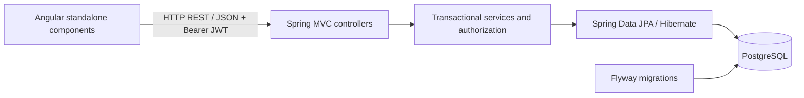
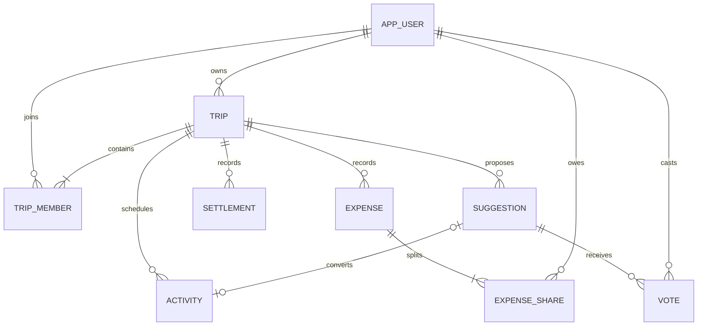

# TripBoard technical specification

## Versions

Angular/CLI **21.2.24**, TypeScript **5.9.3**, RxJS **7.8.2**; Java **21** (tested Temurin **21.0.12.1+1**), Spring Boot **3.5.6**, Maven wrapper **3.9.11**, PostgreSQL **17.6**. Frontend builds were verified with Node **20.19.5** and npm **9.2.0**. Playwright **1.56.1** supports browser regression checks. Frontend dependencies are locked in `package-lock.json`; Spring Boot’s parent manages compatible backend dependency versions.

## Architecture

The API uses `/api`, resource-oriented routes and 200/201/204 success responses; invalid input, unauthenticated, forbidden and missing resources return 400/401/403/404. Controllers validate DTOs and delegate to services. Services perform membership/ownership checks, financial calculations and transactions. Repositories handle persistence; response mapping runs inside transactions with Open Session in View disabled. `@RestControllerAdvice` returns JSON error messages.

Angular uses standalone components, an auth guard, a JWT interceptor and services for HTTP communication. Feature folders separate authentication, trips, itinerary, expenses, suggestions and members; shared dialogs/forms avoid duplication. HTML templates are separate from component logic. Signals hold view state; RxJS handles requests. The local proxy forwards `/api` to Spring Boot. The frontend does not calculate authoritative financial values.

## Authentication and authorization

Registration validates unique identifiers and hashes passwords with BCrypt. Spring Security verifies HS256 JWT signature, issuer and expiration using an environment-provided key of at least 32 bytes. Tokens expire after eight hours and are stored in session storage. Every trip resource checks membership; owner-only actions and creator/owner editing rules live in backend services. Trip writes acquire a row lock to serialize membership and financial mutations; suggestion voting/decisions read state after that lock. A database unique constraint independently prevents duplicate votes.

## Relational model

Six versioned Flyway migrations define all nine entities, indexes, monetary checks and foreign keys. Membership `(trip,user)`, vote `(suggestion,user)` and share `(expense,user)` pairs are unique. Trip-specific records cascade when a trip is deleted; expense shares and suggestion votes cascade with their parent. Deleting an activity clears its suggestion link. User references never cascade into account deletion. Creator fields provide editing permissions.

## Financial rules and verification

Amounts use `BigDecimal` and PostgreSQL `NUMERIC(12,2)`. Equal splits allocate remainder cents by ascending user ID. `balance = paid − shares + settlements sent − settlements received`; balances sum to zero. A dedicated calculator greedily matches debtors and creditors. Unit tests exercise rounding, balances, settlements and simplification; MockMvc tests exercise authentication, authorization, CRUD and voting. The same integration suite can run on PostgreSQL with real migrations. Playwright covers the browser flows and desktop/mobile layouts. Configuration, commands and intentional MVP limitations are detailed in the README.
